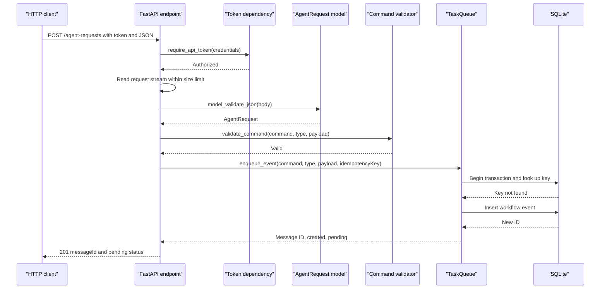
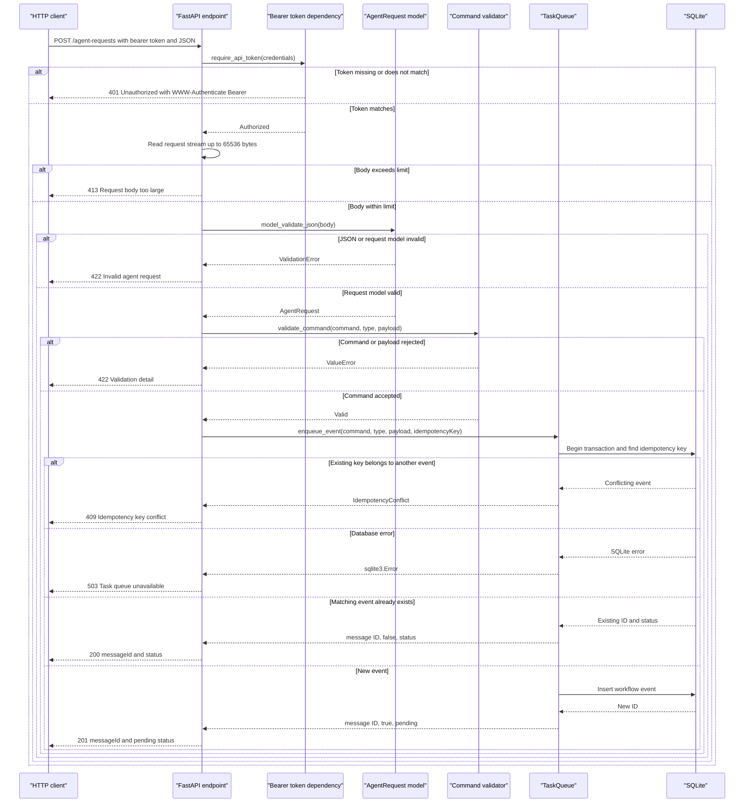

# Agent request API sequence

These UML sequence diagrams follow the [GeeksforGeeks sequence diagram guide](https://www.geeksforgeeks.org/system-design/unified-modeling-language-uml-sequence-diagrams/): participants have lifelines, calls appear in time order as solid arrows, and replies use dashed arrows. They describe the `POST /agent-requests` flow in [app.py](app.py), from authentication through validation and durable queueing.

## Happy path

A valid new request is persisted as a pending event and receives a `201` response.

<!-- mermaid-checked: every participant uses `participant Id as "Label"`, no \n in aliases/messages/notes, every alt/opt/loop closed by end, no `:` inside any alias -->

## Full request flow

<!-- mermaid-checked: every participant uses `participant Id as "Label"`, no \n in aliases/messages/notes, every alt/opt/loop closed by end, no `:` inside any alias -->

At startup, the application lifespan reads `AGENT_API_TOKEN_FILE` and `TASK_QUEUE_DB`, loads the bearer token, and initializes `TaskQueue`; missing or unusable configuration prevents startup. The endpoint queues events but does not run the worker. The diagram shows calls as synchronous interactions even though the HTTP handler is declared `async`; no fire-and-forget dispatch occurs in this endpoint.
