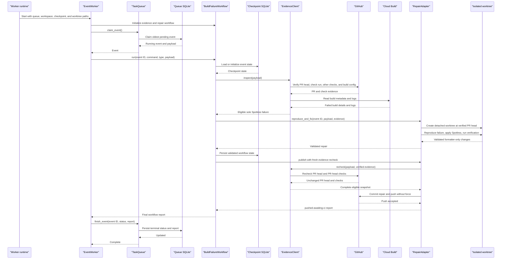
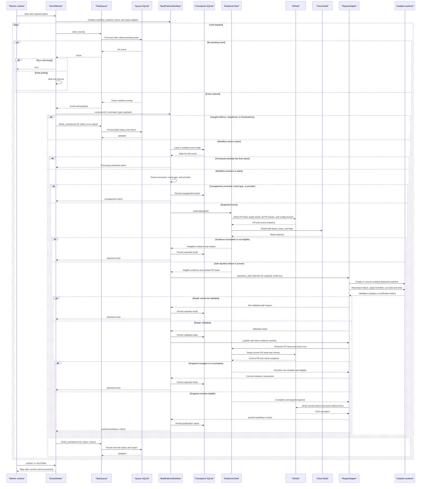

# Workflow event worker sequence

These UML sequence diagrams follow the [GeeksforGeeks sequence diagram guide](https://www.geeksforgeeks.org/system-design/unified-modeling-language-uml-sequence-diagrams/): participants have lifelines, calls appear in time order as solid arrows, and replies use dashed arrows. They describe how [worker.py](worker.py) claims a structured event, runs its checkpointed workflow, and persists the result.

## Happy path

A supported Cloud Build failure event is verified, repaired in an isolated worktree, rechecked before push, and recorded as `pushed-awaiting-ci`.

<!-- mermaid-checked: every participant uses `participant Id as "Label"`, no \n in aliases/messages/notes, every alt/opt/loop closed by end, no `:` inside any alias -->


## Full event processing flow

This view includes idle polling, unsupported or ineligible events, repair and publication safeguards, and workflow failures.

<!-- mermaid-checked: every participant uses `participant Id as "Label"`, no \n in aliases/messages/notes, every alt/opt/loop closed by end, no `:` inside any alias -->


The worker polls every two seconds by default; `--until-empty` exits when no event is pending. SIGINT or SIGTERM sets the stop flag, and the current event processing finishes before the loop stops. Workflow exceptions caught by the worker (`OSError`, `ValueError`, and `RuntimeError`) are reported as failed events; other failures in queue handling are not silently converted to success.

Run the event worker with persistent queue and checkpoint databases, an existing workspace, and a separate writable worktree root:

```sh
PYTHONPATH=agent-workspace:agent-workspace/task-queue \
  python3 agent-workspace/worker/worker.py \
    --queue-db /path/to/state/task-queue.sqlite3 \
    --checkpoints /path/to/state/workflow-checkpoints.sqlite3 \
    --workspace /path/to/created-fwmt-workspace \
    --worktree-root /path/to/state/triage-worktrees
```

The worker does not invoke a prompt runner or automatically retry interrupted events. After confirming the worker has stopped, use `recover-events` and inspect the checkpoint, worktree, and remote state before any `retry-event ID`; in particular, a prior push attempt can have an uncertain outcome. A `pushed-awaiting-ci` result means the repair commit was pushed, not that CI passed.
